# 반석 가금 생산·방역 관리 시스템 (v1)

반석LTC와 고객 산란계 농장이 함께 쓰는 시스템입니다. 농장주는 매일 생산 기록을 넣고, 반석은 그 기록과 부검·검사 결과를 묶어 백신프로그램을 설계하고 결과를 확인합니다.

- 요구사항·양식·용어 정리: [반석LTC 시스템 구축 — 데이터 양식·용어·요구사항 정리](https://claude.ai/artifact/JQbF9ZaWLAP19poB7aTZfY)
- 설계서: [반석LTC 가금 생산·방역 관리 시스템 설계서 v0.1](https://claude.ai/artifact/PoMN4Hdjakc8hBNaTTtrVa)

## 지금 들어 있는 것 (1단계: 생산 MVP 중)

| 영역 | 내용 |
| --- | --- |
| 농장주 모바일 일일 입력 | 동 목록, 큰 숫자 키패드, 판 단위 입력, 어제 값 표시·복사, 실시간 산란율, 경고, 오프라인 보관 |
| 백엔드 API | 농장·계사·계군·일일기록, PIN 로그인, 농장별 권한, 수수 자동 계산, 지표·경고 |
| 엑셀 이관 | 농장 사양관리현황(월별 가로형 시트) → 일일 기록, 계군 자동 추정, 검증 리포트. 양식별 어댑터 구조 |
| 농장주 운영 대시보드 | 앱의 '현황' 탭: 동별 최근 7일 산란율, 우리 농장 과거 계군 같은 일령 대비 위치, 4주 추이, 폐사·사료 |
| 반석 정식 보고서 | 계군 산란 성적 보고서(A4 인쇄·PDF), 정식 발행 시 번호 부여·결과 고정, 원자료 CSV·지문 ([데모 예시](docs/sample-report-demo.pdf)) |
| 농장 엑셀 업로드 | 농장주가 자기 엑셀을 직접 올림 → 그 농장에 지정된 파서로 필수 값만 읽음 → 미리보기(기간, 계사별 건수, 새로/고침/그대로, 경고) → 반영. 업로드 기록, 원본 보관·다시 받기, 되돌리기 |
| 백신 프로그램 | 백신 마스터(혼합 구성·균주·경로), 주령별 접종 일정을 가진 프로그램(버전 관리), 계군 적용·변경 이력(이유), 반석 접종 기록(로트·수수·담당), 예정 대비 실시(완료·밀림·이번 주·예정), 여러 농장 접종 일정판. 농장은 자기 계군 일정·기록 보기 |
| 계군 관리 | 입추 등록(계사, 입추일, 수수, 품종, 부화장), 계사 이동(육성→산란, 전입 수수), 출하·도태로 종료, 고치기, 마지막 단계 되돌리기. 농장주·반석 모두 사용. 날짜를 바꾸면 그 계사의 일일 기록을 맞는 계군에 다시 붙이고 수수를 다시 계산 |
| 폐사 신고·부검 | 농장 폐사 신고 → 반석 알림 → 부검 시간 제안 → 농장 수락 또는 다른 시간 요청 → 확정 → 부검 사진·결과 → 농장에 공유. 양쪽 메시지, 앱 안 알림, 계사 최근 폐사·산란 그래프 |
| 반석 데이터 분석기 | 지표 × 가로축(날짜·주·월·일령·주령) × 묶음(계군·계사·농장·프로그램 적용 여부)을 골라 바로 차트로 보고, 대시보드에 쌓아 저장·공유. 위젯 제목·폭·순서·형태(선·막대·표) 편집, 위젯별 CSV |

<p>
  
  
  
  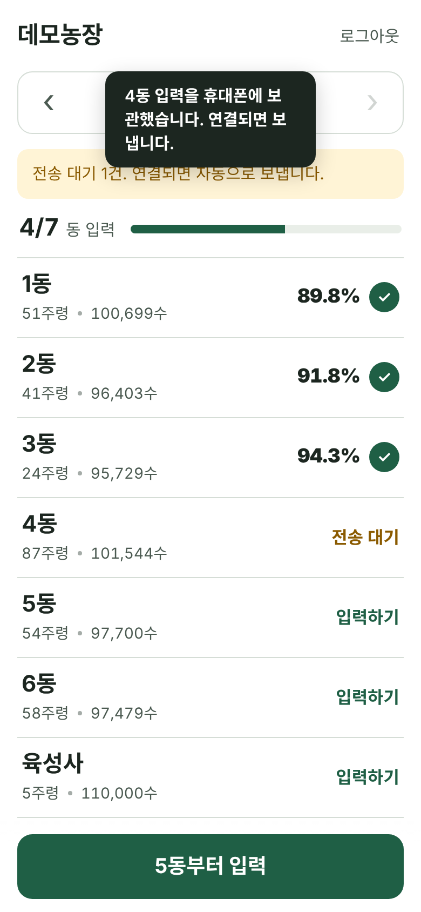
  
</p>

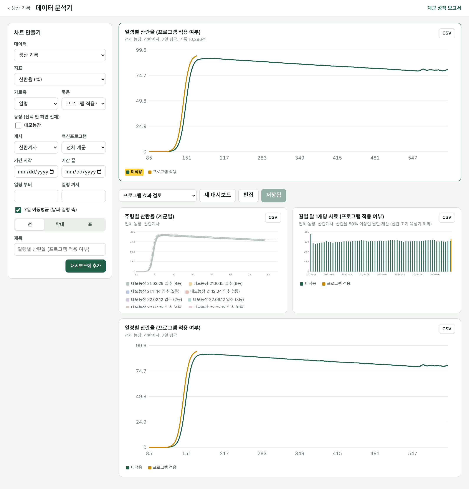

### 분석기 계산 규칙

- 묶음 안의 비율은 모두 총량의 비율입니다 (산란율 = 산란 수 합 ÷ 수수 합). 하루 비율을 평균하지 않습니다.
- 산란율 105% 초과일은 산란율에서 빠집니다. 알 1개당 사료는 산란율 50% 이상인 날만 계산합니다 (산란 초기에는 알이 적어 값이 수천 g로 튑니다).
- 기본은 산란계사만 봅니다. 육성사는 '계사' 조건에서 고릅니다.
- 계열이 60개를 넘으면 기록이 많은 60개만 그립니다. 백신프로그램 적용 계군은 이름 뒤에 ★가 붙습니다.
- 분석기와 대시보드 API는 반석 계정만 쓸 수 있습니다. 대시보드는 만든 사람 것이고, '반석 팀에 공유'를 켜면 다른 반석 계정도 보고 고칠 수 있습니다 (공유 해제·삭제는 만든 사람만).

## 농장 엑셀 업로드

농장마다 엑셀 모양이 달라서 **농장별로 파서(읽는 코드)를 하나씩** 둡니다. 새 농장이 생기면 그 농장 엑셀을 받아 파서를 개발하고, 관리자 화면 > 농장 > '엑셀 양식'에서 지정하면 농장주가 바로 업로드할 수 있습니다. 화면·대시보드·보고서는 공통 일일 기록만 읽으므로 파서가 늘어도 바뀌지 않습니다.

| 경우 | 처리 |
| --- | --- |
| 그 날짜·계사에 기록이 없음 | 새로 넣음 |
| 예전 엑셀 업로드로 들어온 날 | 새 파일 값으로 고침 (월 파일을 다시 올리면 갱신) |
| 앱에서 직접 입력한 날 | **그대로 둠** (업로드 화면에서 '직접 입력한 날도 덮어쓰기'를 켜면 엑셀 값으로) |
| 값이 이미 같음 | 그대로 |
| 엑셀 칸이 비어 있음 | 기존 값을 지우지 않음 |
| 농장에 없는 계사 이름 | 건너뛰고 경고 (계사를 자동으로 만들지 않음) |
| 오늘 이후 날짜 | 건너뜀 |

- 들어가는 값은 수수, 폐사, 도태, 규격별 산란수, 난중, 체중, 사료, 급수, 최저·최고 온도, 습도뿐입니다. 산란율 같은 계산값은 넣지 않습니다.
- 계군은 엑셀에서 만들지 않습니다. 기록은 계군 관리에 등록된 계군에 자동으로 붙고, 계군이 없는 날은 미리보기에서 알려 줍니다.
- 반영한 업로드는 되돌릴 수 있습니다 (새로 넣은 날은 지우고, 고친 날은 이전 값으로). 반영 뒤 사람이 고친 날은 되돌리지 않고 건수를 알려 줍니다.
- 원본 파일은 `STORAGE_DIR/imports/`에 보관해 업로드 기록에서 다시 받을 수 있습니다.
- 지금 등록된 파서: `sayang_monthly` (사양관리현황, 월별 시트). 실제 9년치 파일(일일 기록 약 2만 건)로 확인: 읽기 약 5초, 반영 약 3초, 되돌리기 약 4초.
- 파서 추가 방법은 `backend/app/importers/__init__.py` 맨 위에 적혀 있습니다.

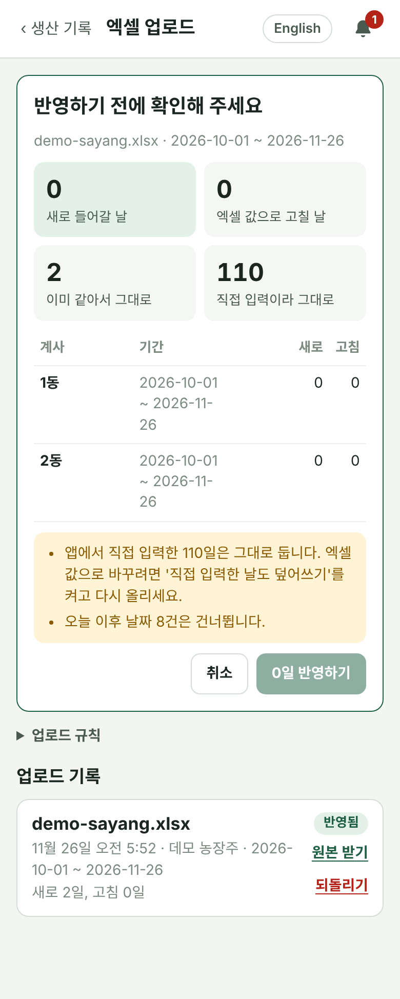

## 백신 프로그램

- **백신**: 제품명, 제조사, 생독·사독·벡터, 기본 접종 경로, 성분(대상 질병·균주). 혼합백신은 성분을 여러 줄로 적습니다.
- **프로그램**: 이름과 버전, 주령(주+일)별 접종 항목(백신, 경로, 메모). 계군에 이미 적용한 프로그램은 일정을 그대로 고치지 않고 **새 버전**으로 저장해, 지난 계군이 실제로 따른 일정이 남게 했습니다.
- **계군 적용**: 계군마다 프로그램을 적용·변경·중단하고 날짜와 이유를 남깁니다. 중간에 바꾸면 바꾸기 전 항목은 이전 버전, 이후 항목은 새 버전 기준입니다.
- **접종 일정**: 예정일 = 입추일 + 항목 일령. 상태는 완료(접종 기록 있음), 밀림(예정일 지남), 이번 주(7일 안), 예정. 일정에서 '접종함'을 누르면 그 항목에 연결된 접종 기록(날짜, 경로, 수수, 로트, 담당)이 남습니다. 프로그램 밖 접종도 따로 기록합니다.
- **반석 접종 일정판**: 모든 농장의 밀린 접종과 앞으로 7·14·30일 접종을 한 화면에.
- 분석기와 보고서의 '프로그램 적용 계군' 비교는 이 적용 기록으로 동작합니다 (`Flock.program_name`은 적용 때 함께 고치는 표시용 값).
- 농장주는 자기 계군의 프로그램, 일정, 접종 기록을 볼 수 있고 고칠 수는 없습니다.

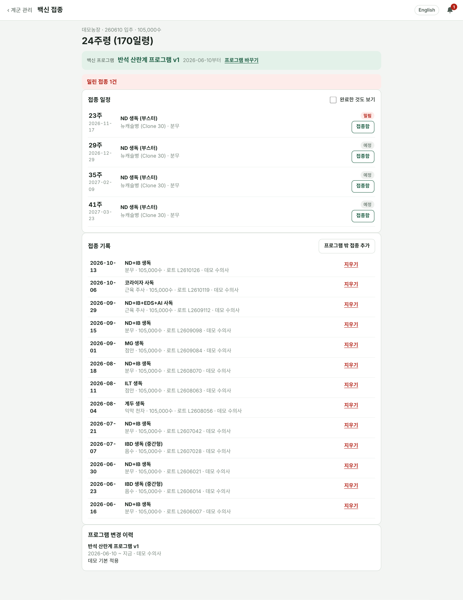

## 폐사 신고와 부검

| 단계 | 농장 | 반석 |
| --- | --- | --- |
| 신고 | '폐사·부검' 탭 또는 일일 입력에서 폐사 경고가 뜨면 바로 신고. 동, 폐사 수, 언제부터, 증상(쉬운 말), 사진 | 알림 (반석 전원) |
| 일정 | 제안받은 시간 중 하나를 누르거나, 다른 시간 요청 | 가능한 시간 1~3개 제안 + 담당 수의사 지정. 농장이 요청한 시간이나 전화로 정한 시간은 바로 확정 |
| 부검 | 일정 알림, 메시지 | 현장에서 휴대폰으로 사진 촬영·업로드, 결과 작성 (장기별 소견, 의심 질병, 의뢰 검사, 소견 요약, 권고, 내부 메모) |
| 결과 | 공유되면 알림, 결과와 부검 사진 확인 | '농장에 결과 공유'를 눌러야 농장에 보임. 이후 고치면 농장에 다시 알림 |

- 진행 기록과 메시지가 한 화면에 시간순으로 남습니다.
- 알림은 모든 화면 오른쪽 위 종 모양에 빨간 숫자로 표시됩니다 (웹·설치한 앱 같음, 45초마다·화면으로 돌아올 때 확인). 누르면 최근 알림 목록, 항목을 누르면 그 건으로 갑니다. 홈 화면에 설치한 앱은 지원하는 기기에서 앱 아이콘에도 표시됩니다.
- 반석 목록은 '반석이 할 일 / 예정된 부검 / 농장 답 기다리는 중 / 지난 기록'으로 나뉩니다.
- 사진은 휴대폰에서 최대 2560px로 줄여 보내고(전파가 약한 계사 대비), 서버는 위치 정보 등 촬영 정보를 지운 JPEG와 썸네일을 저장합니다. 사진 주소는 권한 확인 후 1시간짜리 서명 링크로만 열립니다.
- 사진 파일은 개발에서는 `backend/data/uploads/`(저장소에 안 올라감), 운영(AWS)에서는 S3에 둘 예정입니다. 사진마다 나중에 태깅할 칸(장기, 소견, 진단)이 이미 있습니다.
- 증상·장기·소견·질병·검사 목록은 `frontend/lib/cases.ts` 한 곳에 있어 반석 용어에 맞게 고칠 수 있습니다. 목록에 없는 질병은 직접 적을 수 있습니다.
- 고병원성 AI를 의심 질병으로 고르면 방역기관 신고 안내가 뜹니다.
- **최종 진단**: 부검 결과와 따로, 보통 검사 결과가 나온 뒤 질병 코드로 정합니다 (여러 개 가능, '원인 미확정' 따로). 부검 때 의심한 질병과 이 건의 검사 양성 결과가 후보로 보이고 누르면 들어갑니다. 공유한 건이면 농장에 알림. 반석 목록에 '최종 진단 대기'가 따로 모이고, 유행 질병·분석기는 최종 진단이 있으면 그것을, 없으면 의심 질병을 씁니다.
- 신고·기록·알림 시각은 UTC로 저장하고 화면에서 기기 시간으로, 부검 일정은 현장 시각(`LOCAL_TZ`, 기본 Asia/Seoul) 그대로 저장합니다.

<p>
  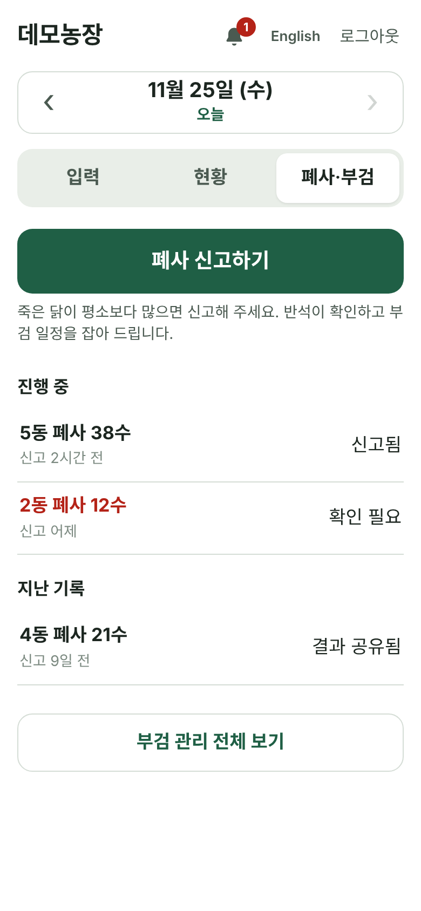
  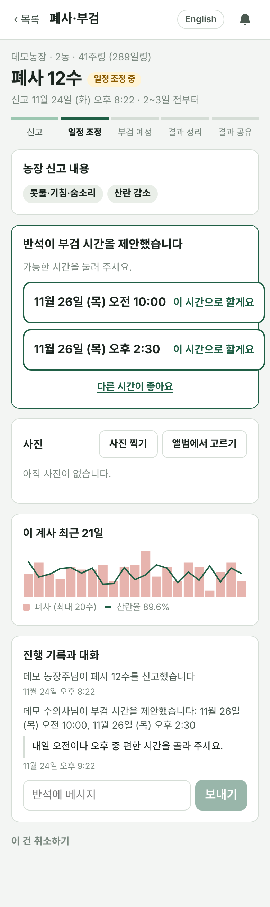
</p>
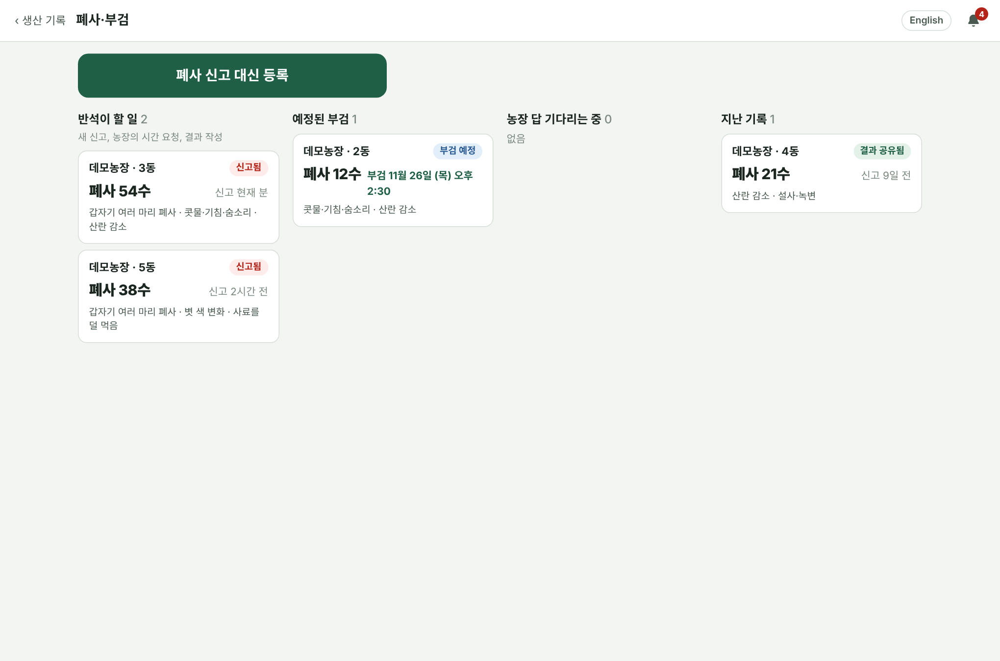
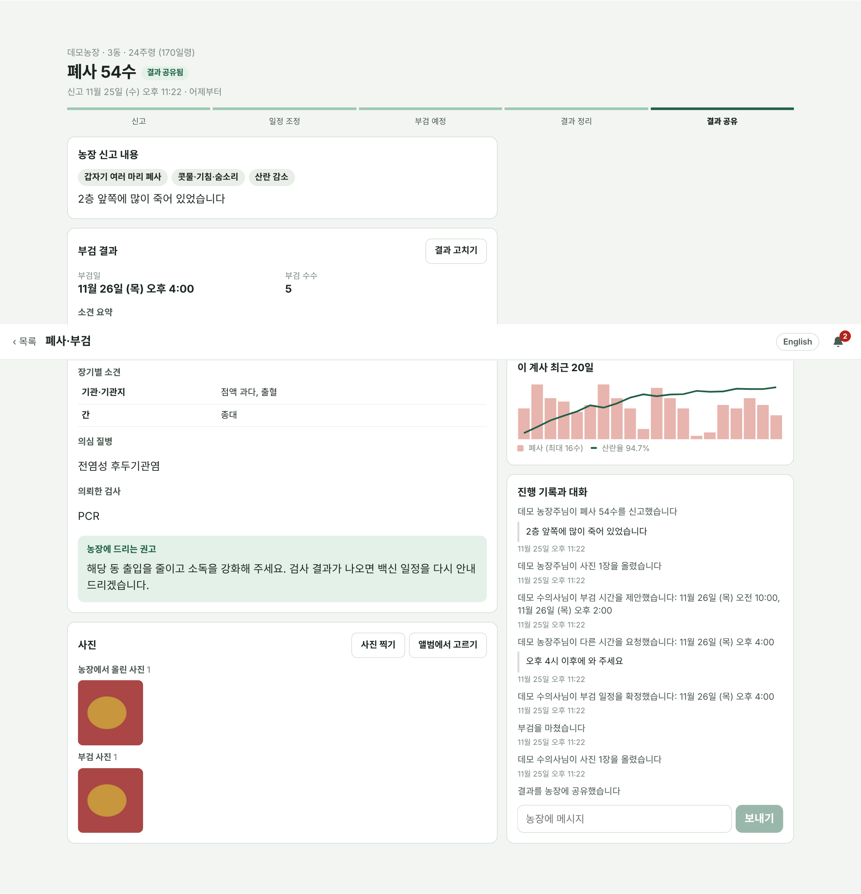

## 접종 알림

서버가 30분마다 접종 일정을 보고 종 알림을 보냅니다 (같은 알림은 한 번만, `BANSUK_REMINDERS=0`이면 끔).

| 받는 사람 | 알림 |
| --- | --- |
| 농장주 | 접종 3일 전부터 '접종 예정', 예정일이 지났는데 기록이 없으면 '접종 밀림' |
| 반석 | 월요일에 '이번 주 접종 예정 N건 (농장 M곳)', 밀린 접종 |

농장 홈 '현황' 맨 위에 밀린 접종과 2주 안 접종 예정이 보입니다. 알림을 누르면 그 계군의 접종 화면(반석은 이번 주 요약 → 접종 일정판)으로 갑니다.

## 질병 검사 결과

반석 검사 성적서(PCR·혈청 항체가)와 같은 구조로 입력·발행합니다.

| 종류 | 입력하는 것 | 화면 |
| --- | --- | --- |
| PCR·배양·기타 | 접수번호, 의뢰자, 의뢰일·채취일, 검사 방법, 검사 대상(성적서 표기), 질병 코드, 시료별 양성/음성/의심 (대조 시료 표시), 값(Ct 등), 검사 소견 | 시료 표, 양성/음성 표시 |
| 혈청 항체가 | 채혈일, 항원(ND HI, LPAI HI, IB·MG·MS·APV·CIAV ELISA 등), 구분(층·차량), 역가군 0~18별 마리 수 | 성적서와 같은 역가군 표, 평균 자동 계산, 계사별 항체가 추이 차트 |

- 계사와 채취일을 고르면 그날 그 계사에 있던 계군과 일령을 자동으로 찾습니다 (직접 적은 일령이 우선).
- 저장하면 '작성 중'이고 농장에는 안 보입니다. '발행'하면 농장에 알림이 가고, 발행한 결과를 고치면 '수정됨' 알림이 갑니다.
- 부검 건 화면에서 '+ 결과 입력'을 누르면 그 부검 건에 연결된 검사로 만들어집니다 (의뢰한 검사 → 결과 → 부검 건의 최종 진단).
- 성적서 파일 올리기: 지금은 반석 표준 입력 양식(엑셀, 화면에서 내려받기)만 읽습니다. 실제 성적서 파일 형식이 정해지면 `backend/app/lab_importers/`에 양식별 파서를 추가합니다 (농장 엑셀 파서와 같은 방식, 공통 출력 형태는 `__init__.py` 설명 참고). 올린 파일은 모두 '작성 중'으로 들어가 확인 후 발행합니다.
- 항원 목록은 `backend/app/lab_catalog.py`와 `frontend/lib/lab.ts`에 있습니다.

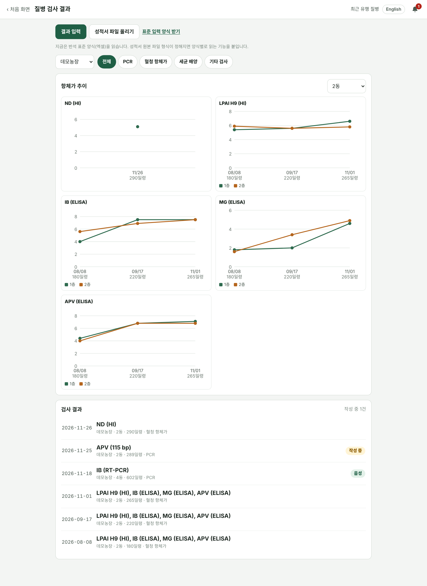
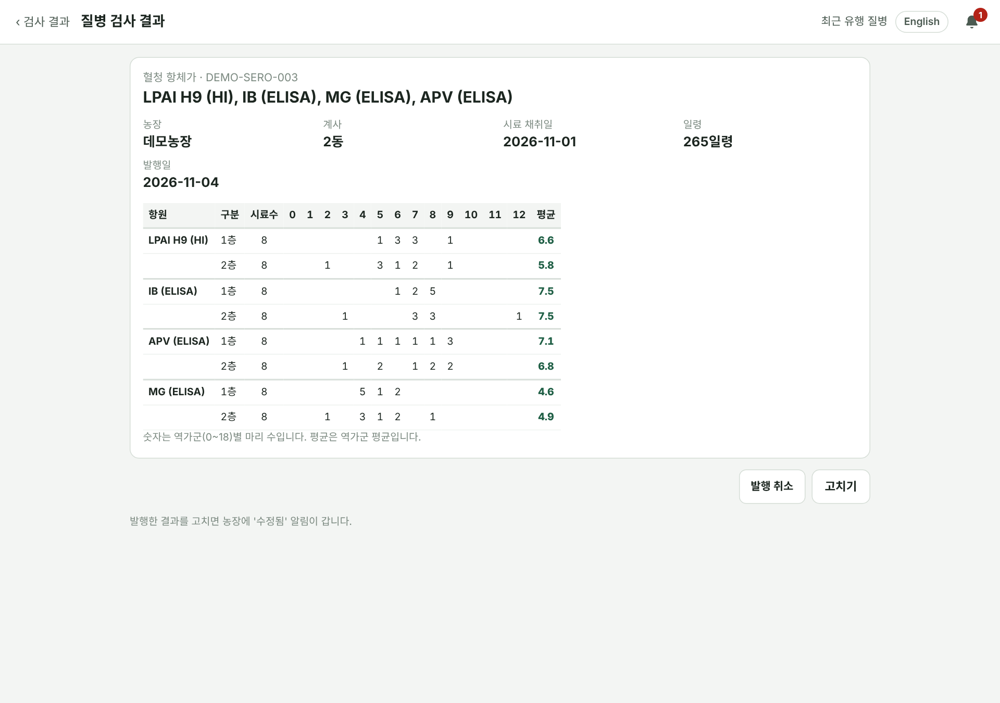

## 최근 유행 질병

부검에서 의심한 질병과 발행된 PCR·배양 양성 결과를 기간(30·90·180일·1년)·지역·질병별로 모읍니다.

- 한 발생 = 농장 × 질병 × 날짜. 같은 농장·질병이 부검과 검사에 7일 안에 함께 나오면 한 번만 세고 '검사 확인'으로 표시합니다.
- 질병별: 건수, 직전 같은 기간 대비, 주별 막대(최근 2주 강조), 농장 수, 지역. 지역별 표, 최근 발생 목록.
- 혈청 항체가는 백신 영향이 커서 넣지 않습니다.
- 반석은 농장 이름까지, 농장 계정은 농장 이름 없이 지역·질병만 봅니다.
- 같은 데이터가 분석기의 '부검 기록'(부검 건수·신고 폐사수, 질병·지역별)과 '검사 결과'(검사 건수·양성 건수·양성 비율·평균 역가군, 질병·항원·계군별) 출처로도 들어갑니다.

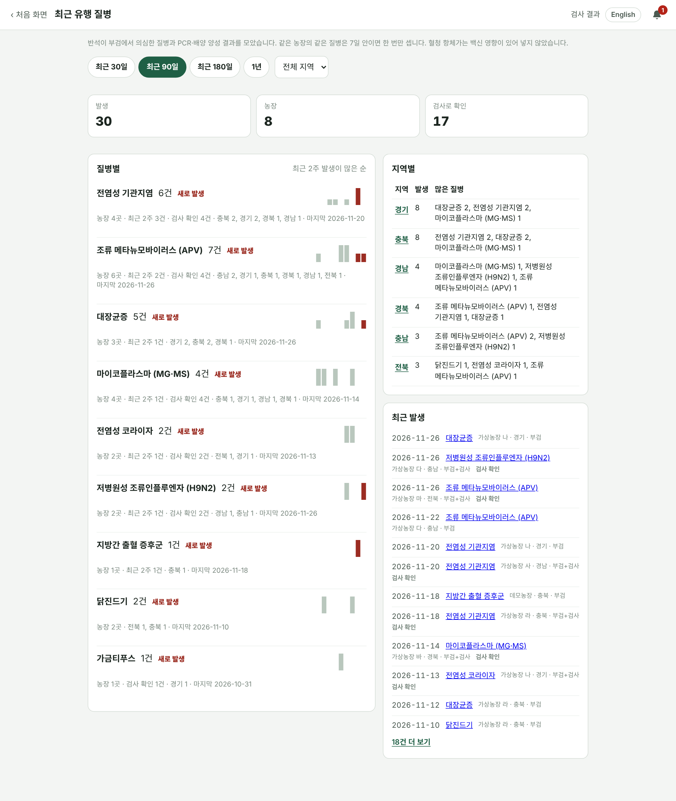

## 부검 사진 태깅·장기 자동 인식 (반석 전용)

수의사가 부검 사진에 장기 윤곽을 그리고 장기·소견을 붙인 뒤, 사진마다 질병을 정합니다. 이렇게 쌓인 사진으로 장기 인식 모델을 학습하면, 그다음부터는 사진을 올릴 때 장기가 자동으로 표시되고 수의사는 틀린 것만 고칩니다. 외부 AI API를 쓰지 않아 사진당 비용이 없고 사진이 밖으로 나가지 않습니다.

- **사진 모으기**: 부검 건에서 올린 사진은 자동으로 태깅 목록에 들어옵니다. 지난 사진은 '지난 부검 사진 올리기'로 여러 장을 한꺼번에 올립니다 (30장씩 나눠 보냄, 같은 사진은 두 번 안 들어감).
- **태깅**: '윤곽 그리기'를 켜고 장기 둘레를 한 번에 둘러 그리거나 점을 찍습니다 → 장기 고르기 → 소견(출혈·종대 등) → 사진의 질병 또는 '이상 없음' → '완료하고 다음 사진'. 점을 끌어 모양을 고칠 수 있고, 흐린 사진은 '건너뛰기(학습 제외)'.
- **자동 표시**: `backend/data/models/organs.onnx`(+ `.json`)가 있으면 켜집니다. 제안은 점선으로 보이고, '맞음'을 누르거나 고쳐야 완료할 수 있습니다. 수의사가 확인한 영역은 모델을 다시 돌려도 바뀌지 않습니다.
- **학습**: '학습 데이터 받기'로 받은 zip을 `training/train_organs.py`로 학습합니다 (GPU PC나 무료 Colab, Mask R-CNN, 상업 사용 가능한 BSD 라이선스). 결과 파일을 서버에 넣으면 끝. 서버는 CPU(onnxruntime)로 한 장에 1~2초.
- 좌표는 사진 크기 대비 비율로 저장해서 원본·축소본 어디에나 맞습니다. 내보내기는 반석 형식(dataset.json)과 COCO 형식(coco.json) 둘 다 들어갑니다.
- 장기·소견 목록은 `frontend/lib/cases.ts`와 `backend/app/vision/labels.py`. 장기별 학습 목표(기본 150개)는 `TARGET_PER_ORGAN`.

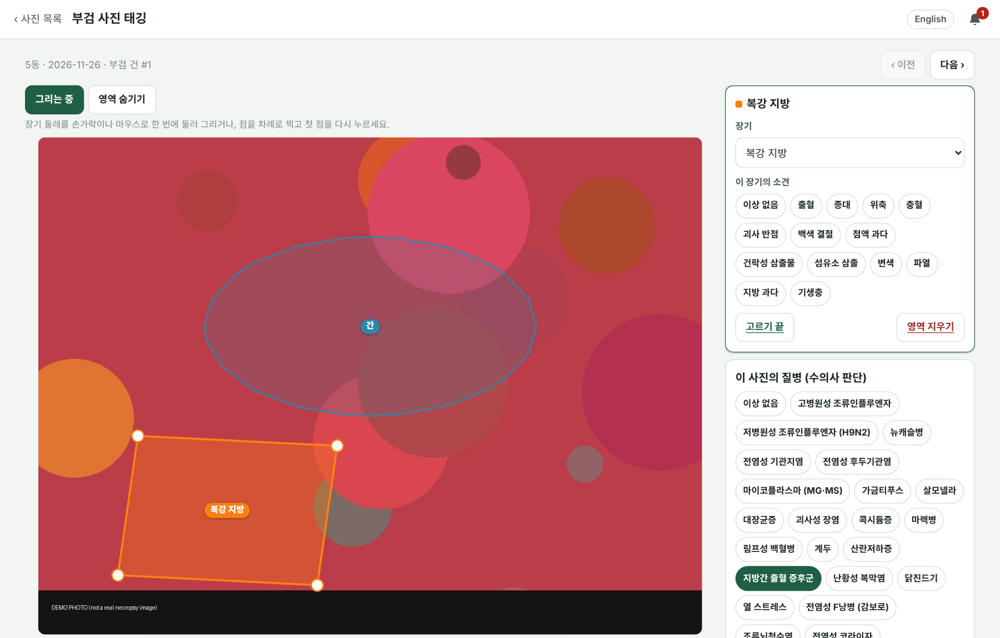
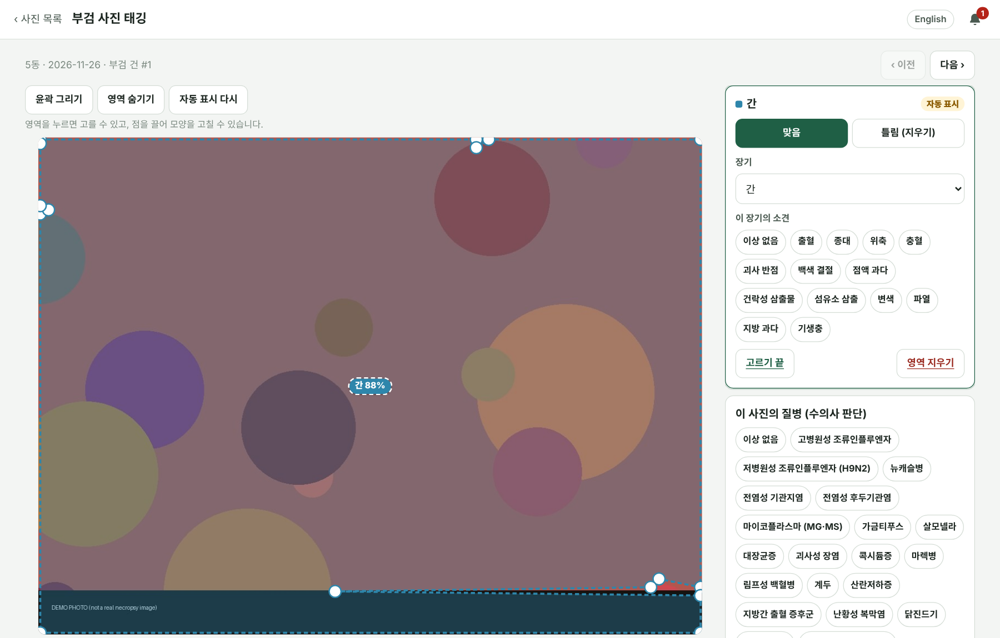

## 언어 (한국어 · English)

- 모든 화면 오른쪽 위의 **English / 한국어** 버튼으로 바꿉니다. 고른 언어는 그 기기에 기억됩니다.
- 화면 문구는 `frontend/lib/en.ts`, 서버가 만드는 문구(오류, 경고, 보고서 주의 사항, 지표·규격 이름)는 `backend/app/i18n.py`에서 번역합니다. 한국어 원문이 곧 키입니다.
- 농장·계사·계군 이름, 검토 의견처럼 사람이 입력한 값은 번역하지 않습니다.
- 발행된 보고서도 영어로 볼 수 있습니다 (저장된 결과는 그대로, 표시만 번역). [영어 예시](docs/sample-report-demo-en.pdf)
- 새 문구를 `t("...")`로 감싸고 `en.ts`에 영어를 넣지 않으면 빌드가 멈춥니다 (`npm run check-i18n`).
- 규격 중 **무대·무중**은 정확한 영어 용어를 확인하지 못해 `Mudae`, `Mujung`으로 두었습니다.

## 권한

- 농장주는 로그인하면 자기 농장 데이터만 봅니다 (모든 API가 요청마다 농장 권한을 확인, 다른 농장은 403).
- 반석 계정(수의사·연구원, 직원, 관리자)은 모든 농장을 봅니다. 정식 보고서 발행과 분석기는 반석만 쓸 수 있습니다.
- 계정·농장 관리는 반석 관리자만 합니다.

## 계정과 보안

- **가입 기능은 없습니다.** 반석 관리자가 '계정·농장 관리' 화면에서 반석 연구원·직원 계정과 농장 계정을 만들고, 농장과 계사, 농장별 입력 항목도 여기서 정합니다.
- **처음 서버를 띄우면 관리자 계정 하나가 만들어진 상태로 시작합니다** (관리자가 한 명도 없을 때만). 번호는 `BANSUK_ADMIN_PHONE`, 임시 비밀번호는 `BANSUK_ADMIN_INITIAL_PIN`. 비밀번호를 주지 않으면 서버 로그에 한 번 출력합니다.
- **임시 비밀번호 → 첫 로그인 때 재설정.** 계정을 만들거나 초기화하면 숫자 6자리 임시 비밀번호가 화면에 한 번만 나옵니다. 7일 안에 로그인해 새 비밀번호를 정해야 하고, 정하기 전에는 다른 API가 모두 막힙니다 (403 `pin_change_required`).
- 새 비밀번호 규칙: 농장 계정은 숫자 6자리 (휴대폰 숫자 키패드), 같은 숫자 반복·연속 숫자·휴대폰 번호 일부는 불가. 반석 계정은 영문과 숫자를 섞은 8자 이상.
- **저장 방식**
  - 비밀번호: scrypt 해시만 저장.
  - 휴대폰 번호: AES-256-GCM으로 암호화해 저장하고, 로그인 조회는 HMAC 블라인드 인덱스로 합니다. DB만 유출되어서는 번호를 알 수 없습니다.
  - 로그인 토큰: 원문은 기기에만 있고 DB에는 SHA-256 값만. 농장 휴대폰은 180일, 반석 계정은 30일 유지.
- 5번 연속 틀리면 10분 잠금 (관리자가 바로 풀 수 있음). 비밀번호를 바꾸거나 초기화하면 다른 기기의 로그인은 끊깁니다.
- 계정을 끄면 즉시 로그아웃되고, 관리자는 최소 한 명 남아 있어야 합니다.
- 계정·농장 변경, 비밀번호 설정·초기화, 잠금은 '변경 기록'에 남습니다 (비밀번호 값은 남기지 않음).
- 암호화 키 `BANSUK_DATA_KEY`는 `python -m app.crypto`로 만듭니다. 운영(`BANSUK_ENV=production`)에서 키가 없으면 서버가 뜨지 않습니다. 키를 잃으면 저장된 번호를 되살릴 수 없으니 따로 보관해야 합니다. 개발에서는 `backend/data/dev-data.key`를 자동으로 만듭니다 (저장소에 올라가지 않음).

<p>
  
  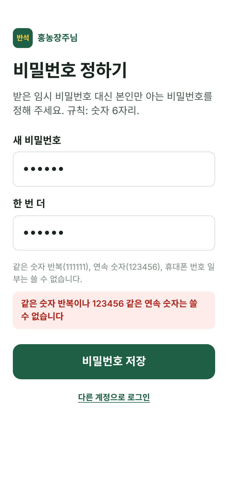
</p>
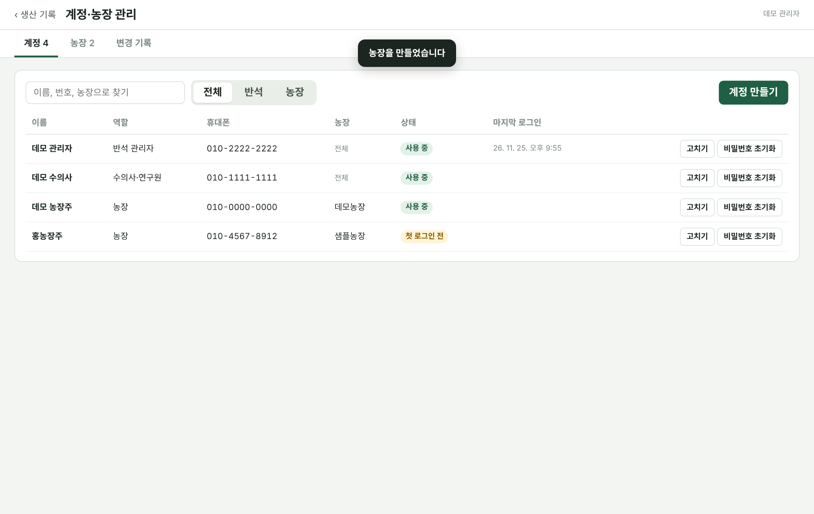

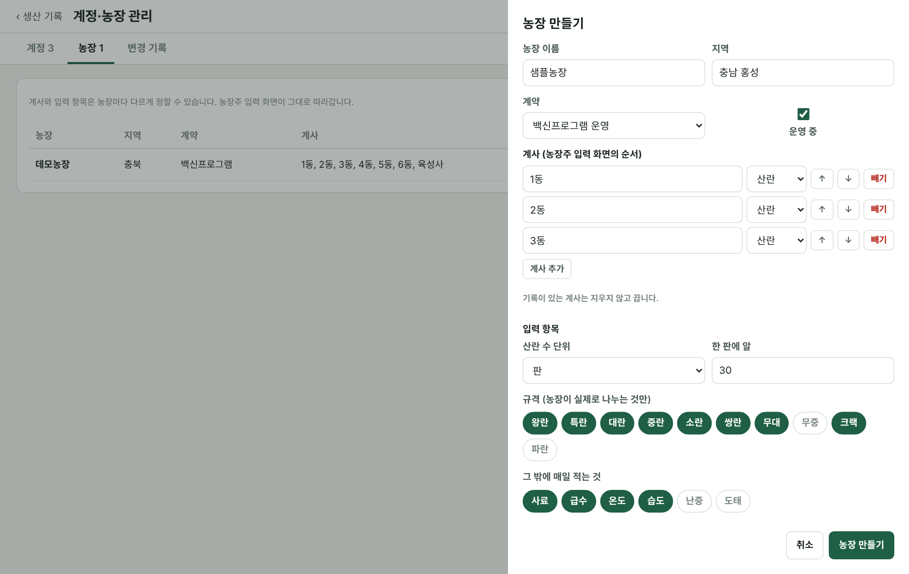

## 보고서를 믿을 수 있게 만드는 장치

- 비교는 같은 농장의 과거 계군과 **같은 일령끼리**. 기본 구간은 7일 평균 산란율 50% 도달 이후.
- 구간 지표는 하루 비율의 평균이 아니라 총량의 비율. 산란율 105% 초과일(집란 시점 문제)은 곡선에서 제외하고 그 수를 밝힘.
- 비교 계군 수, 기록 누락 비율, 보정하지 않은 요인(사료·계절·부화장·점등)을 보고서에 자동으로 적음.
- 정식 발행하면 번호(BS26-RPT-0001)를 매기고 결과를 그대로 저장. 발행 후 원자료가 바뀌면 보고서에 표시.
- 원자료 지문(해시)과 원자료 CSV로 같은 데이터에서 같은 결과가 나오는지 확인 가능.

## 일일 입력 화면을 이렇게 만든 이유

농장주와 관리인은 계사 안에서, 장갑을 끼거나 손이 더러운 채로, 한 손에 폰을 들고 6~7개 동을 매일 입력합니다. 입력이 번거로우면 기록이 끊기고, 기록이 끊기면 반석의 분석과 백신프로그램 평가가 불가능해집니다.

- **OS 키보드 대신 고정 키패드**: 칸마다 키보드가 오르내리며 화면이 흔들리지 않고, `다음` 한 번으로 다음 칸에 갑니다.
- **판 단위 입력**: 규격별 산란수는 판(30개)으로 넣고 개로 바꿔 저장합니다. 사양관리 엑셀의 규격별 숫자가 모두 30의 배수라 판으로 세고 있다고 보았습니다.
- **어제와 같음**: 어제 값을 옆에 보여 주고, 같으면 한 번 눌러 넣고 다음 칸으로 갑니다.
- **필요한 칸만**: 폐사·규격별 산란·사료가 필수, 급수·온도·습도는 선택. 도태·난중 등은 농장 설정으로 켭니다.
- **저장하면 다음 동으로**: 아직 안 넣은 다음 동이 바로 열립니다. 필수 칸을 다 채웠으면 아무것도 묻지 않습니다.
- **입력 즉시 확인**: 산란율 100% 초과, 폐사 급증(평소 대비 마릿수로 안내), 산란·섭취·급수 급감을 바로 알려 줍니다.
- **전파가 약해도**: 저장이 안 되면 폰에 보관했다가 연결되면 자동으로 보냅니다.

측정(데모 데이터, 헤드리스 브라우저): 한 동을 실제 숫자로 다 넣는 데 터치 36번(대부분 숫자 자체), 어제와 거의 같은 동은 11번.

## 서버에서 실행 (운영)

서버에 저장소를 한 번 받아 두고, 그다음부터는 `./start.sh` 하나만 실행합니다.

```bash
git clone https://github.com/tajogood/bansuk_v1.git
cd bansuk_v1
./start.sh
```

`./start.sh`가 하는 일:

1. GitHub에서 최신 코드를 받습니다 (`git pull`).
2. 처음이면 `backend/.env`를 만들고 암호화 키를 자동 생성합니다. 첫 관리자 번호와 이름을 묻습니다.
3. 백엔드 패키지를 설치합니다 (바뀐 경우만).
4. 화면을 빌드합니다 (화면 코드가 바뀐 경우만, 1~2분).
5. 서버를 재시작하고 정상 응답을 확인합니다.
6. 처음이면 **암호화 키**와 **첫 관리자 임시 비밀번호**를 보여 줍니다. 키는 따로 보관하세요.

| 명령 | 하는 일 |
| --- | --- |
| `./start.sh` | 업데이트하고 (재)시작 |
| `./start.sh stop` | 멈춤 |
| `./start.sh status` | 돌고 있는지 확인 |
| `./start.sh logs` | 서버 기록 보기 |
| `./start.sh key` | 암호화 키 다시 보기 |

- 화면과 API를 서버 하나(기본 포트 8000)에서 같이 내보냅니다. 인터넷에 공개할 때는 앞에 HTTPS(Nginx, Caddy 등)를 두세요.
- 필요한 것: Python 3.11 이상, Node.js 20 이상, git.
- 코드를 받지 않고 재시작만: `NO_PULL=1 ./start.sh`
- 서버를 옮길 때는 `backend/.env`(키 포함)와 DB를 함께 옮깁니다.

## 개발용 실행

```bash
# 백엔드
cd backend
pip install -r requirements.txt
python -m app.seed                 # 가상 데모 데이터 (bansuk.db)
uvicorn app.main:app --reload --port 8000

# 프론트엔드
cd frontend
cp .env.example .env.local         # NEXT_PUBLIC_API_URL
npm install
npm run dev                        # http://localhost:3000
```

데모 계정 (`python -m app.seed`): 반석 관리자 `010-2222-2222` / `bansuk2026`, 수의사 `010-1111-1111` / `bansuk2026`, 농장주 `010-0000-0000` / `246810`

테스트: `cd backend && python -m pytest`

### 사양관리 엑셀 이관

```bash
cd backend
python -m app.importers.sayang 사양관리현황.xlsx --farm "농장명" --dry-run   # 검증 리포트만
python -m app.importers.sayang 사양관리현황.xlsx --farm "농장명" --csv out.csv
python -m app.importers.sayang 사양관리현황.xlsx --farm "농장명"             # DB에 반영
```

- 행 위치가 해마다 달라서 A열 항목명·B열 동 이름으로 찾습니다.
- 산란율·수사비 같은 계산값은 가져오지 않고 원자료만 가져옵니다 (기존 엑셀의 월 평균 수식 오류를 반복하지 않기 위해).
- 주령 칸 형식이 시기마다 달라(`333-47`, `57-405`) 큰 숫자를 일령으로 읽고, 앞뒤 3일 중앙값으로 계군 경계를 정합니다.
- 육성사와 산란계사의 같은 입추일 구간은 한 계군의 이동으로 잇습니다.

**이 저장소는 공개 저장소입니다. 실제 농장 데이터(엑셀, DB)는 커밋하지 않습니다** (`.gitignore`에 `*.xlsx`, `*.db`, `data/`).

## 구조

```
backend/   FastAPI + SQLAlchemy (개발 SQLite, 운영 PostgreSQL: DATABASE_URL)
  app/models.py          데이터 모델
  app/crypto.py          개인정보 암호화
  app/security.py        비밀번호·토큰·권한
  app/bootstrap.py       첫 관리자 생성
  app/services/          수수 계산, 지표·경고, 계군 조회
  app/routers/           API
  app/importers/sayang.py  사양관리 엑셀 이관
frontend/  Next.js 정적 내보내기(PWA), 농장주 모바일 입력
docs/      화면 캡처
```

## 설정

| 환경변수 | 기본값 | 설명 |
| --- | --- | --- |
| `DATABASE_URL` | `sqlite:///./bansuk.db` | 운영은 `postgresql+psycopg://...` |
| `AGE_DAY_BASE` | `1` | 입추일을 몇 일령으로 볼지. 반석 자료마다 0/1이 달라 확정 전까지 설정값 |
| `CORS_ORIGINS` | `http://localhost:3000` | 프론트엔드 주소 (쉼표로 여러 개) |
| `NEXT_PUBLIC_API_URL` | `http://localhost:8000` | 프론트엔드가 부를 API 주소 |
| `BANSUK_DATA_KEY` | (개발: 자동 생성) | 개인정보 암호화 키, 32바이트 base64. 운영 필수 |
| `BANSUK_ENV` | | `production`이면 키가 없을 때 서버를 띄우지 않음 |
| `BANSUK_ADMIN_PHONE` | `010-9999-9999` | 처음 만드는 관리자 번호 |
| `BANSUK_ADMIN_NAME` | `반석 관리자` | 처음 만드는 관리자 이름 |
| `STORAGE_DIR` | `backend/data/uploads` | 사진 저장 위치 (운영은 S3 예정) |
| `LOCAL_TZ` | `Asia/Seoul` | 부검 일정 등 현장 시각의 시간대 |
| `BANSUK_ADMIN_INITIAL_PIN` | (자동 생성, 로그 출력) | 처음 만드는 관리자의 임시 비밀번호 |

## 다음 작업

- 분석기 데이터원: 백신 접종 이력 추가
- 실제 성적서 파일(엑셀) 양식별 파서 (샘플 파일을 받으면)
- 새 농장이 생길 때마다 그 농장 엑셀 파서 개발
- 기존 개발 DB는 계정 구조가 바뀌어 다시 만들어야 함 (`python -m app.seed`). 운영 전 Alembic으로 전환
- 첫 장기 인식 모델 학습 (태깅 300장쯤 모이면), 비슷한 과거 사례 사진 찾기, 질병 추정
- 사진 저장소 S3 연결 (AWS 배포 때)
- Alembic 마이그레이션, 배포 환경
