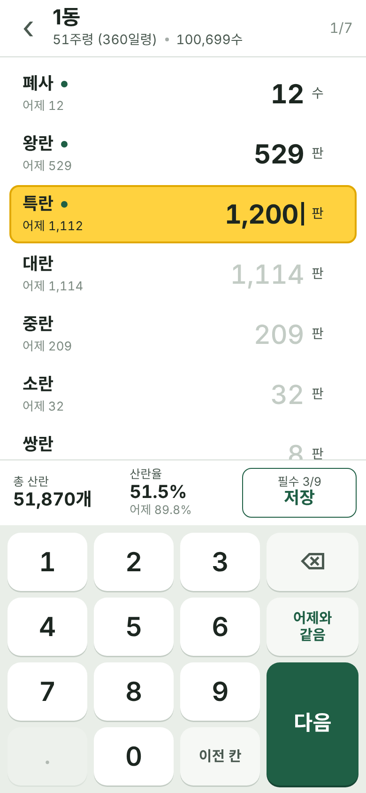
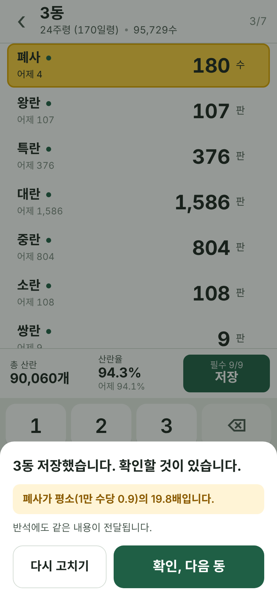
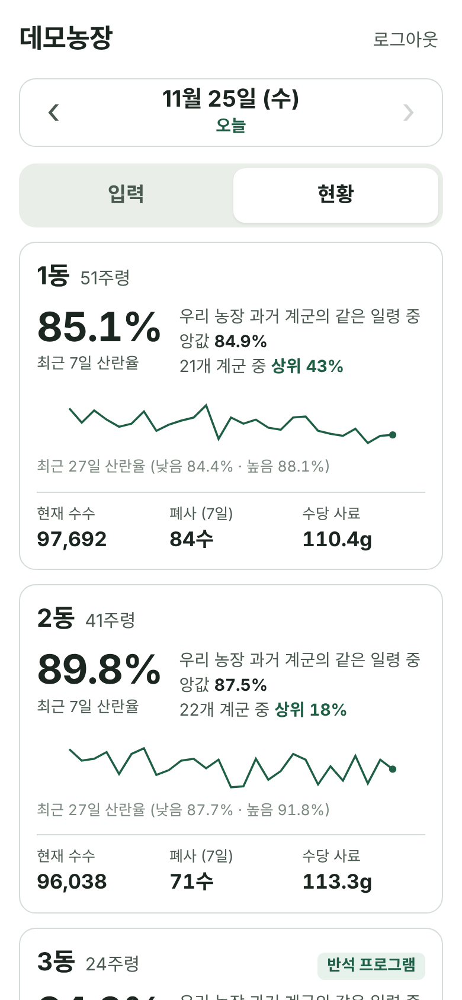
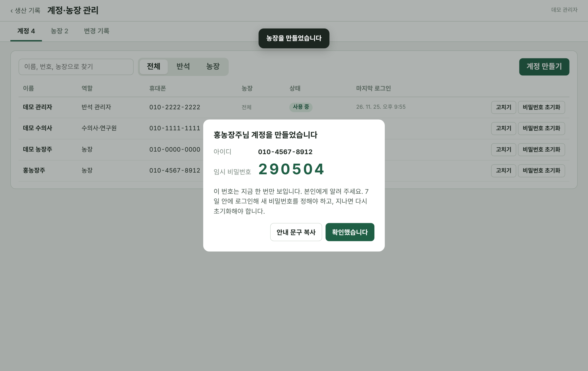

# 반석 가금 생산·방역 관리 시스템 (v1)

반석LTC와 고객 산란계 농장이 함께 쓰는 시스템입니다. 농장주는 매일 생산 기록을 넣고, 반석은 그 기록과 부검·검사 결과를 묶어 백신프로그램을 설계하고 결과를 확인합니다.

- 요구사항·양식·용어 정리: [반석LTC 시스템 구축 — 데이터 양식·용어·요구사항 정리](https://claude.ai/artifact/JQbF9ZaWLAP19poB7aTZfY)
- 설계서: [반석LTC 가금 생산·방역 관리 시스템 설계서 v0.1](https://claude.ai/artifact/PoMN4Hdjakc8hBNaTTtrVa)

## 지금 들어 있는 것 (1단계: 생산 MVP 중)

| 영역 | 내용 |
| --- | --- |
| 농장주 모바일 일일 입력 | 동 목록, 큰 숫자 키패드, 판 단위 입력, 어제 값 표시·복사, 실시간 산란율, 경고, 오프라인 보관 |
| 백엔드 API | 농장·계사·계군·일일기록, PIN 로그인, 농장별 권한, 수수 자동 계산, 지표·경고 |
| 엑셀 이관 | 농장 사양관리현황(월별 가로형 시트) → 일일 기록, 계군 자동 추정, 검증 리포트. 양식별 어댑터 구조 |
| 농장주 운영 대시보드 | 앱의 '현황' 탭: 동별 최근 7일 산란율, 우리 농장 과거 계군 같은 일령 대비 위치, 4주 추이, 폐사·사료 |
| 반석 정식 보고서 | 계군 산란 성적 보고서(A4 인쇄·PDF), 정식 발행 시 번호 부여·결과 고정, 원자료 CSV·지문 ([데모 예시](docs/sample-report-demo.pdf)) |
| 반석 데이터 분석기 | 지표 × 가로축(날짜·주·월·일령·주령) × 묶음(계군·계사·농장·프로그램 적용 여부)을 골라 바로 차트로 보고, 대시보드에 쌓아 저장·공유. 위젯 제목·폭·순서·형태(선·막대·표) 편집, 위젯별 CSV |

<p>
  
  
  
  
  
</p>


### 분석기 계산 규칙

- 묶음 안의 비율은 모두 총량의 비율입니다 (산란율 = 산란 수 합 ÷ 수수 합). 하루 비율을 평균하지 않습니다.
- 산란율 105% 초과일은 산란율에서 빠집니다. 알 1개당 사료는 산란율 50% 이상인 날만 계산합니다 (산란 초기에는 알이 적어 값이 수천 g로 튑니다).
- 기본은 산란계사만 봅니다. 육성사는 '계사' 조건에서 고릅니다.
- 계열이 60개를 넘으면 기록이 많은 60개만 그립니다. 백신프로그램 적용 계군은 이름 뒤에 ★가 붙습니다.
- 분석기와 대시보드 API는 반석 계정만 쓸 수 있습니다. 대시보드는 만든 사람 것이고, '반석 팀에 공유'를 켜면 다른 반석 계정도 보고 고칠 수 있습니다 (공유 해제·삭제는 만든 사람만).

## 언어 (한국어 · English)

- 모든 화면 오른쪽 위의 **English / 한국어** 버튼으로 바꿉니다. 고른 언어는 그 기기에 기억됩니다.
- 화면 문구는 `frontend/lib/en.ts`, 서버가 만드는 문구(오류, 경고, 보고서 주의 사항, 지표·규격 이름)는 `backend/app/i18n.py`에서 번역합니다. 한국어 원문이 곧 키입니다.
- 농장·계사·계군 이름, 검토 의견처럼 사람이 입력한 값은 번역하지 않습니다.
- 발행된 보고서도 영어로 볼 수 있습니다 (저장된 결과는 그대로, 표시만 번역). [영어 예시](docs/sample-report-demo-en.pdf)
- 새 문구를 `t("...")`로 감싸고 `en.ts`에 영어를 넣지 않으면 빌드가 멈춥니다 (`npm run check-i18n`).
- 규격 중 **무대·무중**은 정확한 영어 용어를 확인하지 못해 `Mudae`, `Mujung`으로 두었습니다.

## 권한

- 농장주는 로그인하면 자기 농장 데이터만 봅니다 (모든 API가 요청마다 농장 권한을 확인, 다른 농장은 403).
- 반석 계정(수의사·연구원, 직원, 관리자)은 모든 농장을 봅니다. 정식 보고서 발행과 분석기는 반석만 쓸 수 있습니다.
- 계정·농장 관리는 반석 관리자만 합니다.

## 계정과 보안

- **가입 기능은 없습니다.** 반석 관리자가 '계정·농장 관리' 화면에서 반석 연구원·직원 계정과 농장 계정을 만들고, 농장과 계사, 농장별 입력 항목도 여기서 정합니다.
- **처음 서버를 띄우면 관리자 계정 하나가 만들어진 상태로 시작합니다** (관리자가 한 명도 없을 때만). 번호는 `BANSUK_ADMIN_PHONE`, 임시 비밀번호는 `BANSUK_ADMIN_INITIAL_PIN`. 비밀번호를 주지 않으면 서버 로그에 한 번 출력합니다.
- **임시 비밀번호 → 첫 로그인 때 재설정.** 계정을 만들거나 초기화하면 숫자 6자리 임시 비밀번호가 화면에 한 번만 나옵니다. 7일 안에 로그인해 새 비밀번호를 정해야 하고, 정하기 전에는 다른 API가 모두 막힙니다 (403 `pin_change_required`).
- 새 비밀번호 규칙: 농장 계정은 숫자 6자리 (휴대폰 숫자 키패드), 같은 숫자 반복·연속 숫자·휴대폰 번호 일부는 불가. 반석 계정은 영문과 숫자를 섞은 8자 이상.
- **저장 방식**
  - 비밀번호: scrypt 해시만 저장.
  - 휴대폰 번호: AES-256-GCM으로 암호화해 저장하고, 로그인 조회는 HMAC 블라인드 인덱스로 합니다. DB만 유출되어서는 번호를 알 수 없습니다.
  - 로그인 토큰: 원문은 기기에만 있고 DB에는 SHA-256 값만. 농장 휴대폰은 180일, 반석 계정은 30일 유지.
- 5번 연속 틀리면 10분 잠금 (관리자가 바로 풀 수 있음). 비밀번호를 바꾸거나 초기화하면 다른 기기의 로그인은 끊깁니다.
- 계정을 끄면 즉시 로그아웃되고, 관리자는 최소 한 명 남아 있어야 합니다.
- 계정·농장 변경, 비밀번호 설정·초기화, 잠금은 '변경 기록'에 남습니다 (비밀번호 값은 남기지 않음).
- 암호화 키 `BANSUK_DATA_KEY`는 `python -m app.crypto`로 만듭니다. 운영(`BANSUK_ENV=production`)에서 키가 없으면 서버가 뜨지 않습니다. 키를 잃으면 저장된 번호를 되살릴 수 없으니 따로 보관해야 합니다. 개발에서는 `backend/data/dev-data.key`를 자동으로 만듭니다 (저장소에 올라가지 않음).

<p>
  
  
</p>




## 보고서를 믿을 수 있게 만드는 장치

- 비교는 같은 농장의 과거 계군과 **같은 일령끼리**. 기본 구간은 7일 평균 산란율 50% 도달 이후.
- 구간 지표는 하루 비율의 평균이 아니라 총량의 비율. 산란율 105% 초과일(집란 시점 문제)은 곡선에서 제외하고 그 수를 밝힘.
- 비교 계군 수, 기록 누락 비율, 보정하지 않은 요인(사료·계절·부화장·점등)을 보고서에 자동으로 적음.
- 정식 발행하면 번호(BS26-RPT-0001)를 매기고 결과를 그대로 저장. 발행 후 원자료가 바뀌면 보고서에 표시.
- 원자료 지문(해시)과 원자료 CSV로 같은 데이터에서 같은 결과가 나오는지 확인 가능.

## 일일 입력 화면을 이렇게 만든 이유

농장주와 관리인은 계사 안에서, 장갑을 끼거나 손이 더러운 채로, 한 손에 폰을 들고 6~7개 동을 매일 입력합니다. 입력이 번거로우면 기록이 끊기고, 기록이 끊기면 반석의 분석과 백신프로그램 평가가 불가능해집니다.

- **OS 키보드 대신 고정 키패드**: 칸마다 키보드가 오르내리며 화면이 흔들리지 않고, `다음` 한 번으로 다음 칸에 갑니다.
- **판 단위 입력**: 규격별 산란수는 판(30개)으로 넣고 개로 바꿔 저장합니다. 사양관리 엑셀의 규격별 숫자가 모두 30의 배수라 판으로 세고 있다고 보았습니다.
- **어제와 같음**: 어제 값을 옆에 보여 주고, 같으면 한 번 눌러 넣고 다음 칸으로 갑니다.
- **필요한 칸만**: 폐사·규격별 산란·사료가 필수, 급수·온도·습도는 선택. 도태·난중 등은 농장 설정으로 켭니다.
- **저장하면 다음 동으로**: 아직 안 넣은 다음 동이 바로 열립니다. 필수 칸을 다 채웠으면 아무것도 묻지 않습니다.
- **입력 즉시 확인**: 산란율 100% 초과, 폐사 급증(평소 대비 마릿수로 안내), 산란·섭취·급수 급감을 바로 알려 줍니다.
- **전파가 약해도**: 저장이 안 되면 폰에 보관했다가 연결되면 자동으로 보냅니다.

측정(데모 데이터, 헤드리스 브라우저): 한 동을 실제 숫자로 다 넣는 데 터치 36번(대부분 숫자 자체), 어제와 거의 같은 동은 11번.

## 서버에서 실행 (운영)

서버에 저장소를 한 번 받아 두고, 그다음부터는 `./start.sh` 하나만 실행합니다.

```bash
git clone https://github.com/tajogood/bansuk_v1.git
cd bansuk_v1
./start.sh
```

`./start.sh`가 하는 일:

1. GitHub에서 최신 코드를 받습니다 (`git pull`).
2. 처음이면 `backend/.env`를 만들고 암호화 키를 자동 생성합니다. 첫 관리자 번호와 이름을 묻습니다.
3. 백엔드 패키지를 설치합니다 (바뀐 경우만).
4. 화면을 빌드합니다 (화면 코드가 바뀐 경우만, 1~2분).
5. 서버를 재시작하고 정상 응답을 확인합니다.
6. 처음이면 **암호화 키**와 **첫 관리자 임시 비밀번호**를 보여 줍니다. 키는 따로 보관하세요.

| 명령 | 하는 일 |
| --- | --- |
| `./start.sh` | 업데이트하고 (재)시작 |
| `./start.sh stop` | 멈춤 |
| `./start.sh status` | 돌고 있는지 확인 |
| `./start.sh logs` | 서버 기록 보기 |
| `./start.sh key` | 암호화 키 다시 보기 |

- 화면과 API를 서버 하나(기본 포트 8000)에서 같이 내보냅니다. 인터넷에 공개할 때는 앞에 HTTPS(Nginx, Caddy 등)를 두세요.
- 필요한 것: Python 3.11 이상, Node.js 20 이상, git.
- 코드를 받지 않고 재시작만: `NO_PULL=1 ./start.sh`
- 서버를 옮길 때는 `backend/.env`(키 포함)와 DB를 함께 옮깁니다.

## 개발용 실행

```bash
# 백엔드
cd backend
pip install -r requirements.txt
python -m app.seed                 # 가상 데모 데이터 (bansuk.db)
uvicorn app.main:app --reload --port 8000

# 프론트엔드
cd frontend
cp .env.example .env.local         # NEXT_PUBLIC_API_URL
npm install
npm run dev                        # http://localhost:3000
```

데모 계정 (`python -m app.seed`): 반석 관리자 `010-2222-2222` / `bansuk2026`, 수의사 `010-1111-1111` / `bansuk2026`, 농장주 `010-0000-0000` / `246810`

테스트: `cd backend && python -m pytest`

### 사양관리 엑셀 이관

```bash
cd backend
python -m app.importers.sayang 사양관리현황.xlsx --farm "농장명" --dry-run   # 검증 리포트만
python -m app.importers.sayang 사양관리현황.xlsx --farm "농장명" --csv out.csv
python -m app.importers.sayang 사양관리현황.xlsx --farm "농장명"             # DB에 반영
```

- 행 위치가 해마다 달라서 A열 항목명·B열 동 이름으로 찾습니다.
- 산란율·수사비 같은 계산값은 가져오지 않고 원자료만 가져옵니다 (기존 엑셀의 월 평균 수식 오류를 반복하지 않기 위해).
- 주령 칸 형식이 시기마다 달라(`333-47`, `57-405`) 큰 숫자를 일령으로 읽고, 앞뒤 3일 중앙값으로 계군 경계를 정합니다.
- 육성사와 산란계사의 같은 입추일 구간은 한 계군의 이동으로 잇습니다.

**이 저장소는 공개 저장소입니다. 실제 농장 데이터(엑셀, DB)는 커밋하지 않습니다** (`.gitignore`에 `*.xlsx`, `*.db`, `data/`).

## 구조

```
backend/   FastAPI + SQLAlchemy (개발 SQLite, 운영 PostgreSQL: DATABASE_URL)
  app/models.py          데이터 모델
  app/crypto.py          개인정보 암호화
  app/security.py        비밀번호·토큰·권한
  app/bootstrap.py       첫 관리자 생성
  app/services/          수수 계산, 지표·경고, 계군 조회
  app/routers/           API
  app/importers/sayang.py  사양관리 엑셀 이관
frontend/  Next.js 정적 내보내기(PWA), 농장주 모바일 입력
docs/      화면 캡처
```

## 설정

| 환경변수 | 기본값 | 설명 |
| --- | --- | --- |
| `DATABASE_URL` | `sqlite:///./bansuk.db` | 운영은 `postgresql+psycopg://...` |
| `AGE_DAY_BASE` | `1` | 입추일을 몇 일령으로 볼지. 반석 자료마다 0/1이 달라 확정 전까지 설정값 |
| `CORS_ORIGINS` | `http://localhost:3000` | 프론트엔드 주소 (쉼표로 여러 개) |
| `NEXT_PUBLIC_API_URL` | `http://localhost:8000` | 프론트엔드가 부를 API 주소 |
| `BANSUK_DATA_KEY` | (개발: 자동 생성) | 개인정보 암호화 키, 32바이트 base64. 운영 필수 |
| `BANSUK_ENV` | | `production`이면 키가 없을 때 서버를 띄우지 않음 |
| `BANSUK_ADMIN_PHONE` | `010-9999-9999` | 처음 만드는 관리자 번호 |
| `BANSUK_ADMIN_NAME` | `반석 관리자` | 처음 만드는 관리자 이름 |
| `BANSUK_ADMIN_INITIAL_PIN` | (자동 생성, 로그 출력) | 처음 만드는 관리자의 임시 비밀번호 |

## 다음 작업

- 분석기 데이터원 확장: 검사 결과(항체가·PCR), 부검 기록, 백신 접종 이력
- 농장주 엑셀 업로드 화면 (농장별 매핑 등록)
- 기존 개발 DB는 계정 구조가 바뀌어 다시 만들어야 함 (`python -m app.seed`). 운영 전 Alembic으로 전환
- 부검 기록·사진 업로드
- Alembic 마이그레이션, 배포 환경
